# scruffyherdr

<table>
<tr>
<td><picture><source media="(prefers-color-scheme: light)" srcset="docs/shots/tatooine-day.jpg">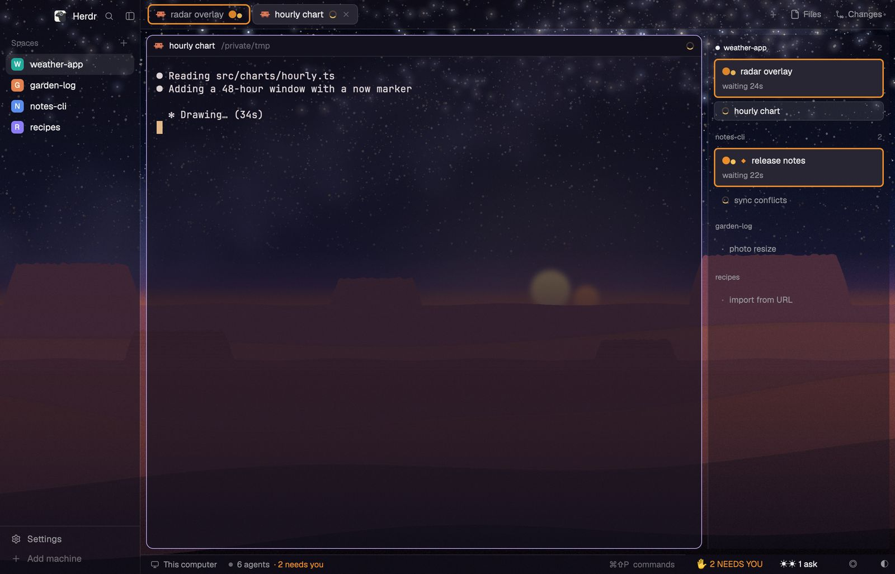</picture></td>
<td><picture><source media="(prefers-color-scheme: light)" srcset="docs/shots/endor-day.jpg">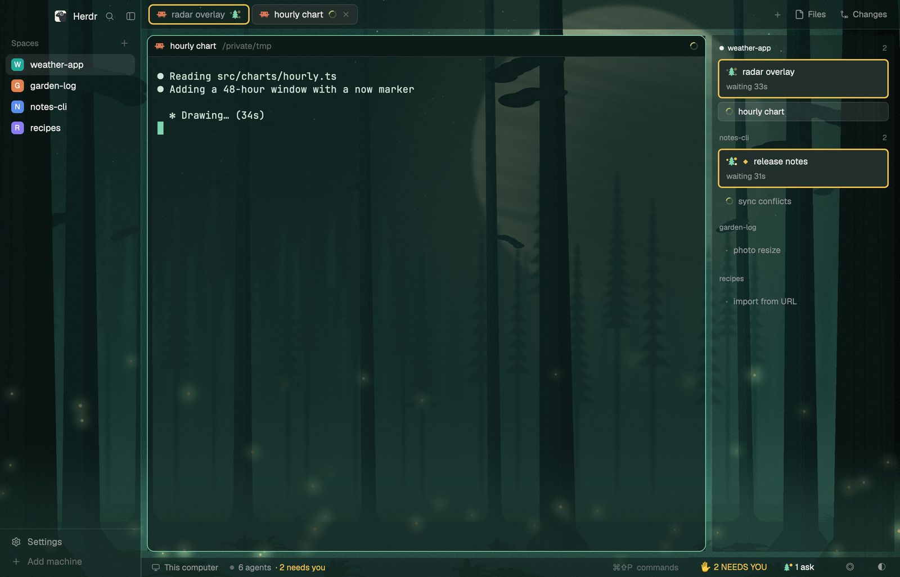</picture></td>
</tr>
<tr>
<td><picture><source media="(prefers-color-scheme: light)" srcset="docs/shots/hoth-day.jpg">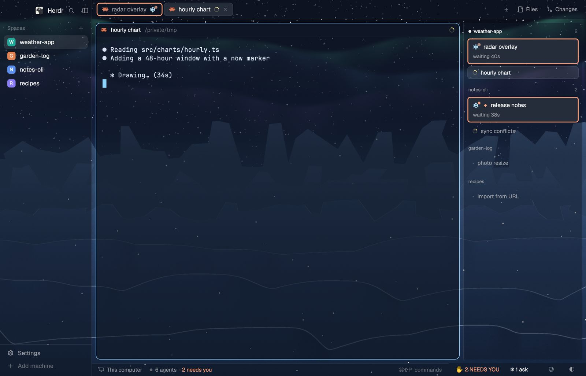</picture></td>
<td><picture><source media="(prefers-color-scheme: light)" srcset="docs/shots/dagobah-day.jpg">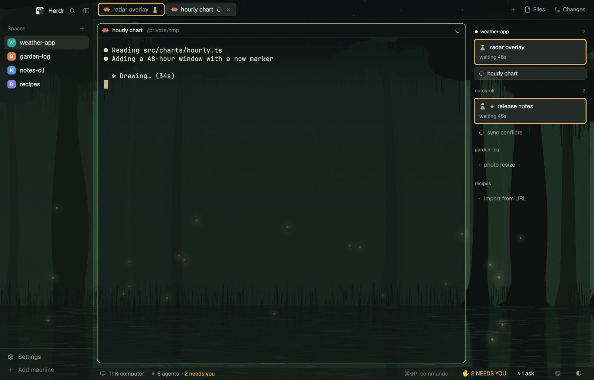</picture></td>
</tr>
<tr>
<td><picture><source media="(prefers-color-scheme: light)" srcset="docs/shots/coruscant-day.jpg">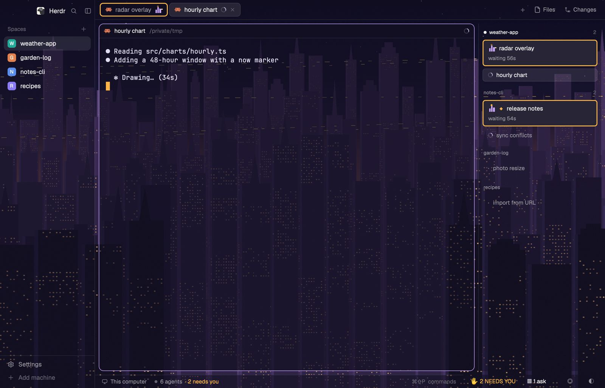</picture></td>
<td><picture><source media="(prefers-color-scheme: light)" srcset="docs/shots/bespin-day.jpg">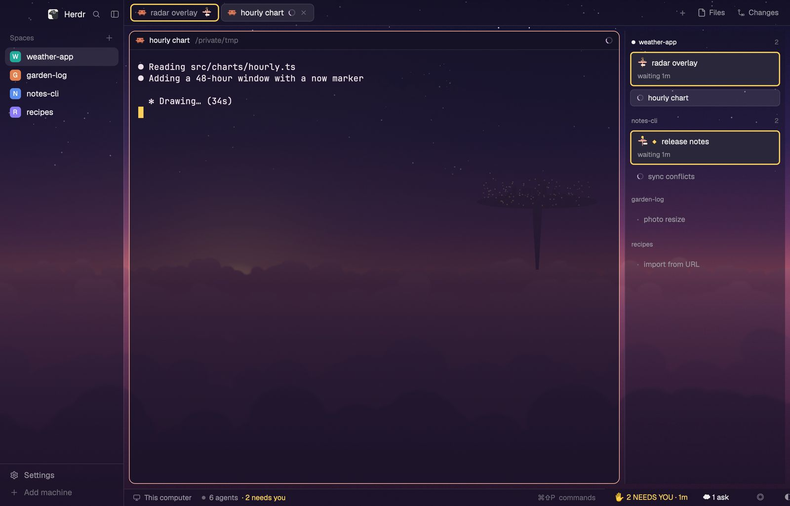</picture></td>
</tr>
<tr>
<td><picture><source media="(prefers-color-scheme: light)" srcset="docs/shots/naboo-day.jpg">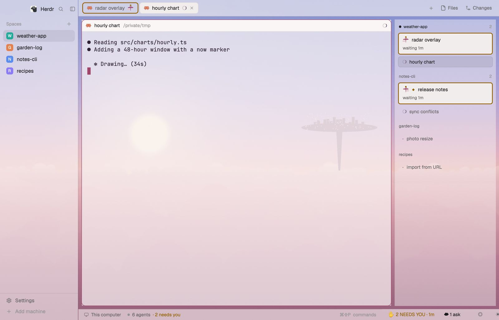</picture></td>
<td><picture><source media="(prefers-color-scheme: light)" srcset="docs/shots/scarif-day.jpg">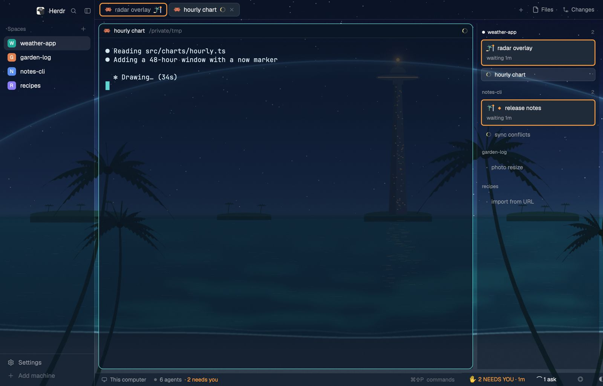</picture></td>
</tr>
<tr>
<td><picture><source media="(prefers-color-scheme: light)" srcset="docs/shots/kamino-day.jpg">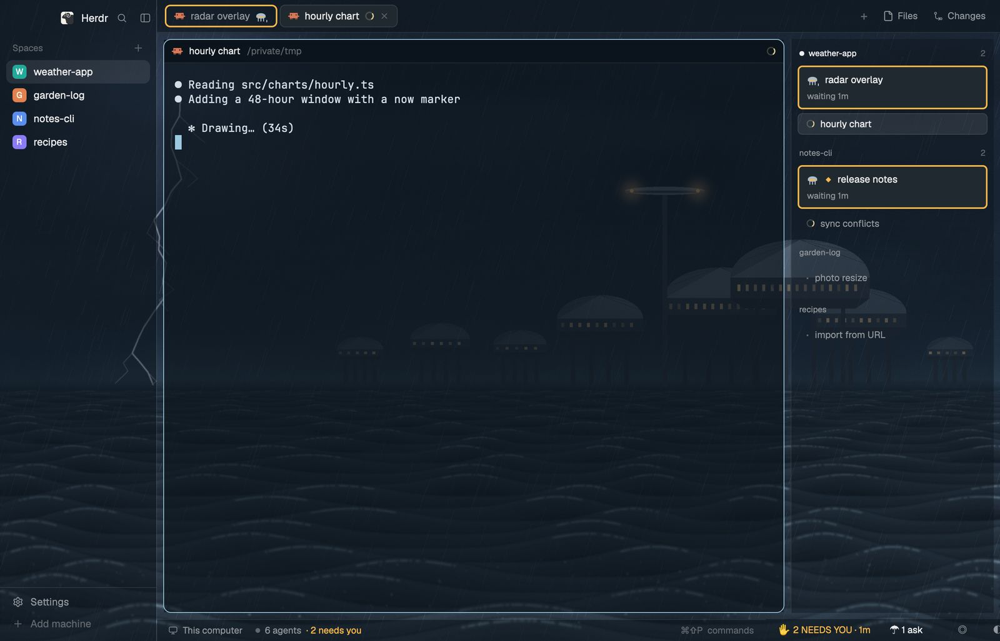</picture></td>
<td><picture><source media="(prefers-color-scheme: light)" srcset="docs/shots/small-moon-day.jpg">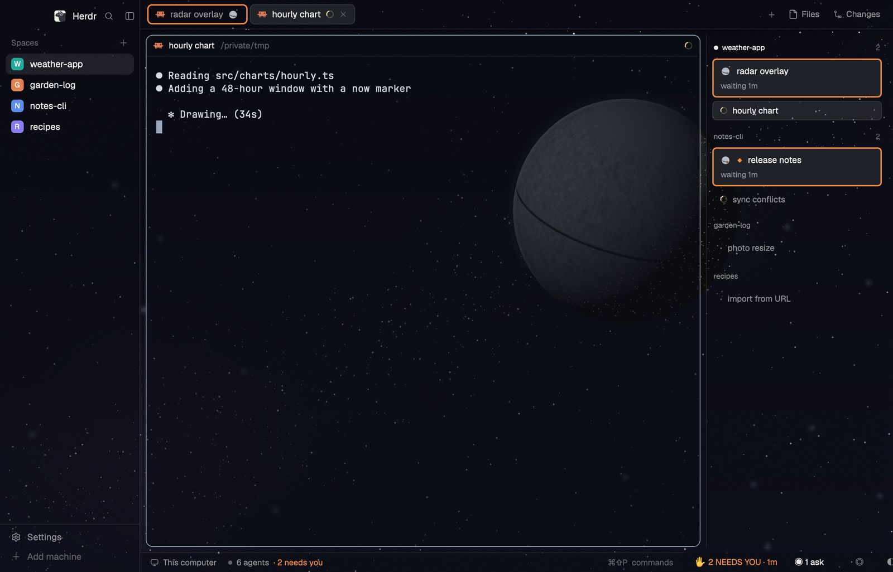</picture></td>
</tr>
</table>

A layout for [Herdr](https://herdr.dev) that makes "this Claude needs you" hard to miss, dressed in ten Star Wars scenes that follow your Mac from night to day.

Unofficial fan project, not affiliated with Lucasfilm or Disney. The pictures are original art.

## What you get

- **A strip** along the bottom: how many Claudes need you, how many are done, and buttons for focus mode, the scene picker and the grid.
- **An urgency rail** on the right: every Claude by name, grouped by space, the ones waiting on you first. A card shows the question or permission prompt a blocked Claude is asking, how long it has waited, and how much context it has left. Click a card to answer from the rail.
- **A grid view** (`cmd-shift-g`): the current space's Claudes tiled, with a spotlight for one at a time.
- **Ten scenes**: Tatooine, Endor, Hoth, Dagobah, Coruscant, Bespin, Naboo, Scarif, Kamino and Small Moon. Each has a night and a day picture, a theme pair, glass panels, and its own needs-you colour and glyph. The scene follows macOS light and dark. Pick one with `cmd-shift-s`.
- **Colour-blind safe**: needs-you is orange (or the scene's own warm hue), done is blue, never red against green, and every state also carries a glyph or a word.

<table>
<tr>
<td>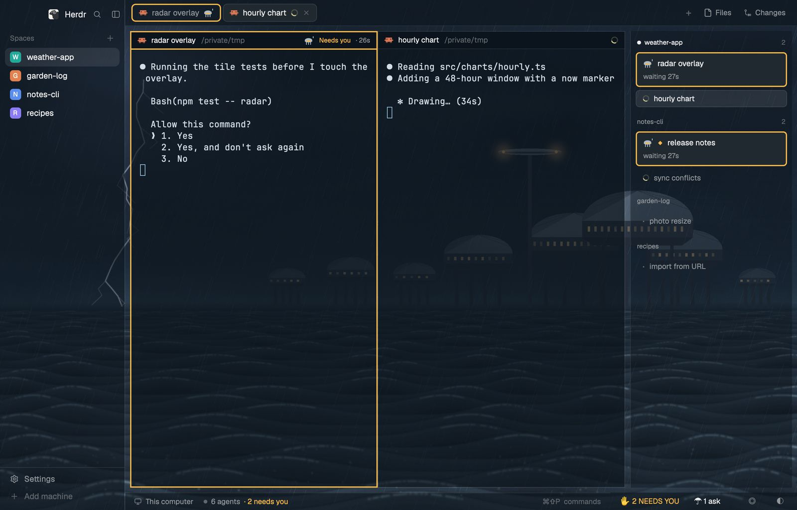</td>
<td>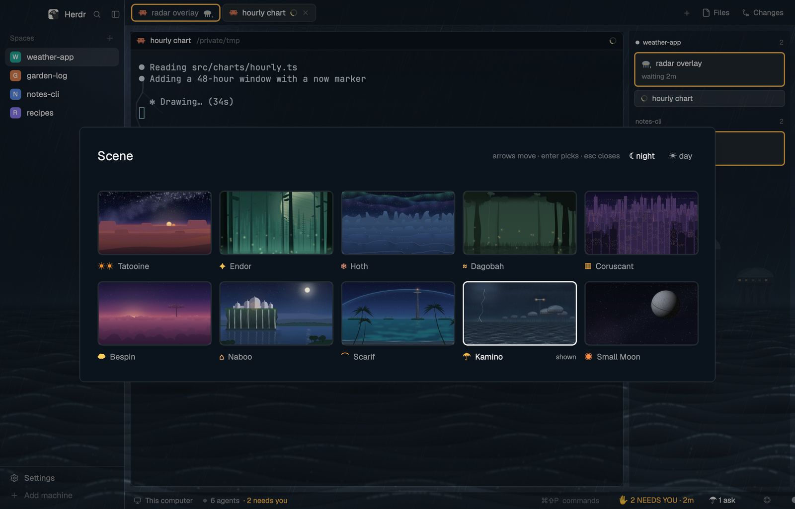</td>
</tr>
<tr><td>The grid (<code>cmd-shift-g</code>)</td><td>The scene picker (<code>cmd-shift-s</code>)</td></tr>
</table>

## Requirements

- macOS, the only platform it's tested on.
- [Herdr](https://herdr.dev) 0.1.15, launched once so `~/.config/herdr-app/layouts/main.json` exists. Install warns on any other version and carries on.
- Node.js 20 or newer to run it; 22.15 or newer to run the tests.
- Claude Code, for the names, questions and context meters.

## Install

```sh
git clone https://github.com/ball42/scruffyherdr.git
cd scruffyherdr
./install.sh
```

Then quit and reopen Herdr: new mods, themes and glyph art load only at start. If the window doesn't open on scruffy, open it with `cmd-shift-s`, or Settings > Look > scruffy (install prints the same line when it couldn't switch the window itself).

Install links the files under `herdr/` into `~/.config/herdr-app/`, builds the `scruffy` layout from Herdr's own main layout, and adds its key bindings to Herdr's `keys.json`, touching only its own entries and backing the file up first.

**Claude Code hooks.** The rail learns each Claude's name, question and tool from a hook in `~/.claude/settings.json`. On a terminal, install asks once before adding it and wrapping your status line (below); Enter adds both. `./install.sh --hooks` adds it without asking and `./install.sh --no-hooks` skips it. With no terminal and no flag, install skips it and tells you how to add it later. Restart running Claude sessions to load the hook.

**Context meters.** Claude Code tells only the status line how much context a session has used. With the hooks, install wraps your status line so the rail can read it: your old command still runs and its output still shows, and your old line is saved in `~/.config/herdr-kit/statusline-prev.json`. If your status line already feeds the meters, or isn't a command, install leaves it alone and says so.

Check the install, or undo it:

```sh
./install.sh --check
./install.sh --uninstall
```

Uninstall removes the hooks and the kit's key bindings, and puts your old status line back exactly as it was if it's still the kit's wrapper. It leaves the links in `~/.config/herdr-app/` (`mods/`, `themes/`, `backgrounds/`, `glyphs/` and `layouts/scruffy.svg`) and your config in place: remove the links by hand, or delete them before you delete the clone, or Herdr is left with links to nothing.

## Keys

| Key | Where | What it does |
| --- | --- | --- |
| `cmd-shift-g` | scruffy | Switch between focus and grid |
| `cmd-alt-]` / `cmd-alt-[` | scruffy, in the grid | Spotlight the next or previous Claude |
| `cmd-shift-a` | scruffy, in the grid | Show every space's Claudes |
| `cmd-shift-s` | scruffy | Open the scene picker; from another layout, switch to scruffy |
| `cmd-shift-u` | scruffy, any pane | Go to the most urgent Claude |
| `cmd-shift-f` | scruffy, any pane | Focus mode: hold back finished Claudes while you're heads-down |

A key you already bound stays yours, and install prints a notice for it. Once `keys.json` is edited, Herdr stops upgrading its default shortcuts in that file.

## Opt-in extras

Everything here is off by default. The ones marked "coming soon" aren't in this repo yet.

| Switch | What it does | |
| --- | --- | --- |
| `readme_tabs` | Keep a README tab first in every space whose repo has one | available |
| `auto_spotlight` | Spotlight a Claude in the grid when it newly needs you | available |
| `pr_status` | Show each Claude's PR state on its rail card | coming soon |
| `usage_meter` | A 5-hour and weekly usage meter on the strip | coming soon |
| `run_cards` | Run buttons for the commands a Claude asks you to run | coming soon |
| `deck` | Stream Deck keys | coming soon |
| `discord_webhook` | One Discord card per stretch away, edited in place | coming soon |

## Config

`~/.config/herdr-kit/config.json` holds these keys. `install.sh` creates the file from `config.example.json` only when it's missing, so add a new key by hand if your file is older.

| Key | Default | What it does |
| --- | --- | --- |
| `discord_webhook` | `""` | Coming soon: an opt-in extra, not in this repo yet (see Opt-in extras). Discord webhook for the away card. Empty turns Discord off. |
| `away_seconds` | `120` | No input for this long counts as away. |
| `grace_seconds` | `60` | A blocked Claude waits this long before it reaches Discord. |
| `done_min_seconds` | `180` | Turns this long or longer join the card. |
| `poll_ms` | `2000` | How often the strip re-reads Herdr. |
| `deck_port` | `47651` | Coming soon: an opt-in extra, not in this repo yet (see Opt-in extras). Local port for the Stream Deck plugin. |
| `deck` | `false` | Coming soon: an opt-in extra, not in this repo yet (see Opt-in extras). Post to the Stream Deck plugin. |
| `auto_spotlight` | `false` | Spotlight a Claude when it newly needs you. |
| `away_toast` | `true` | Show the "while you were away" toast on return. |
| `gh` | `/opt/homebrew/bin/gh` | Coming soon: an opt-in extra, not in this repo yet (see Opt-in extras). GitHub CLI for PR state (`pr_status`). |
| `focus_max_minutes` | `120` | Minutes after which focus mode turns itself off. |
| `readme_tabs` | `false` | Keep a README tab first in every space whose repo has a README. |
| `usage_meter` | `false` | Show the 5-hour and weekly usage meter on the strip and the deck. |
| `pr_status` | `false` | Look up each Claude's PR with `gh` and show its state in the hint line. |
| `run_cards` | `false` | Draw the Run rows a Claude's cards leave on the rail. |
| `run_log_pipe` | `""` | Coming soon: an opt-in extra, not in this repo yet (see Opt-in extras). A command a finished run's record is piped through, given the log's name; it prints the path it filed the log at. Empty writes `~/.config/herdr-kit/runlogs/`. |
| `addons` | `[]` | Add-on mods to run (folder names under Herdr's `mods/`), each in a 0-px block beside the strip. Rerun `./install.sh` after changing it. See [docs/addons.md](docs/addons.md). |
| `look.glass` | `0.6` | How solid the glass tint over the sidebar, tab bar and status bar is (0..1). `false` keeps them solid. Rerun `./install.sh` after changing it. |

## Add-ons

A mod listed in `addons` can put a badge on a Claude's rail card, add rows for work no Claude is on, and add buttons to the strip, all through shared keys. The kit itself holds no add-on logic. See [docs/addons.md](docs/addons.md).

## Contributing

Issues welcome; please open an issue before a PR.

```sh
npm test
bash tests/install.test.sh
```

## License

MIT. See [LICENSE](LICENSE).
