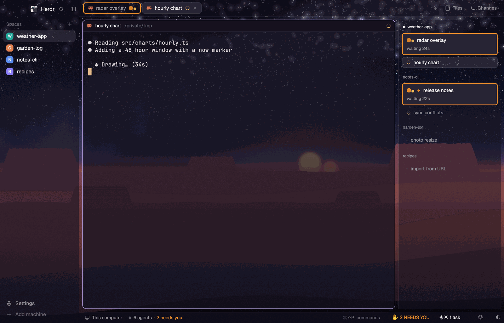

# scruffy

Herdr's own window, dressed as a scene and focused on your Claudes. One picture fills the window behind glass panels: twin suns over a desert, a forest moon, an ice plain, and seven more. A rail on the right lists every Claude, the ones waiting on you first. A strip along the bottom counts them, and one key tiles the current space's Claudes in a grid. Unofficial fan project, not affiliated with Lucasfilm or Disney; the pictures are original art.

**What you see:**

- **Sidebar** on the left, 200px (min 44, max 480; not resizable): Herdr's brand bar (46px), the spaces list, and the footer (69px). Herdr's agents list is there but hidden.
- **Tabs** across the top, 42px (`kit-tabs`): one pill per tab, named after the Claude in it, with the needs-you glyph on a tab that waits on you.
- **The terminal** in the middle: panes as cards, 8px apart with 10px corners, each with a 30px header (`kit-pane`). The header shows the Claude's name and folder, and on the right its state ("Needs you · 26s").
- **The rail** on the right, 260px (drag 200 to 420) (`kit-rail`): every Claude grouped by space, the current space first. A Claude waiting on you is a card with an outline in the needs-you colour, its glyph, and how long it has waited. One that's working has a spinner; done and idle ones are plain rows.
- **The strip** at the bottom right, 300px beside Herdr's status bar (`herdr-signals`): "✋ 2 NEEDS YOU", a count of open questions ("☀☀ 1 ask"), and buttons for focus mode, the scene picker (◐) and the grid.
- **The picture**: the whole window behind the terminals, which are 45% opaque. The sidebar, tabs, rail and bars are clear glass tinted with the scene's panel colour. Night and day pictures follow macOS light and dark.
- **The grid** (`cmd-shift-g`): the current space's Claudes as tiles: two across for up to four, three across for up to nine, and any more as chips below. Each tile has its own header, and a tile waiting on you is outlined in the needs-you colour.

**How it behaves:**

- **Working:** a spinner on the rail row, the tab and the pane header.
- **Blocked** (a permission prompt or a question): orange `#ec8e2c` (on a light theme `#b35900`) and a glyph, on the rail card, tab, pane header, strip and grid tile. The card counts the wait in seconds, then minutes. Each scene picks its own warm hue and glyph: Tatooine ☀☀ `#ec8e2c`, Endor fireflies `#f2c14e`, Hoth ❄ `#ff9e7a`, Dagobah ≈ `#f0b45a`, Coruscant ▥ `#ffb347`, Bespin ☁ `#ffcf5c`, Naboo ⌂ `#ffab66`, Scarif ⌒ `#ff9a3c`, Kamino ☂ `#ffb84a`, Small Moon ◉ `#ff8a3d`.
- **Done** (finished while you weren't looking): blue `#58a6ff` (light `#0969da`) and a ✓. It turns idle once you look.
- **Idle:** a plain row.
- Red is never set against green, and every state also carries a glyph or a word.
- **Keys:** `cmd-shift-g` switches focus and grid. In the grid, `cmd-alt-]` and `cmd-alt-[` spotlight the next or previous Claude, and `cmd-shift-a` shows every space's Claudes. `cmd-shift-s` opens the scene picker, or switches to this layout from another one. `cmd-shift-u` goes to the most urgent Claude, and `cmd-shift-f` toggles focus mode.
- **Clicks:** a rail card focuses its Claude, and in the grid spotlights it. The strip's buttons do what their keys do.
- **Scene picker:** ten thumbnails in two rows. Arrows move, enter picks, esc closes, and night or day can be pinned.

**Built from:**

- The node tree is Herdr's main layout plus three changes. `tabs` becomes `kit-tabs`. `main` gets `pane.header` set to `kit-pane`. The work row gains `rail` (`kit-rail`) after the hidden Files and Changes panel, and the `status` block becomes a row of Herdr's `workspace-status` and `signals` (`herdr-signals`). The rest is Herdr's own `workspace-chrome`, `spaces`, `agents`, `files` and `changes`.
- **`herdr-signals` is the brain**; the `kit-*` mods only draw. Each poll it reads `agents()`, `spaces()` and `panes()` and publishes a view model with `setShared("herdr-kit")`. It rewrites this layout in place with `layout.set` to change scene, picture, glass and view (focus or grid). Shared keys: `kit.scene`, `kit.view`, `kit.scenes`, `kit.sceneWant`, `kit.viewWant`, `kit.grid`, `kit.gridAll`, `kit.spotlight`, `kit.gridFocus`, `kit.pins`, `kit.snooze`.
- `kit-scenes` is the picker, a dialog overlay. A grid tile's header is a `kit-pane` block whose props is the terminal's address.
- **Programs it runs:** `ioreg` (how long the Mac has been idle), `git` (a folder's repo root and remote), `ls`, `find` and `mkdir` on its own files. `kit-rail` runs `hc` to answer a Claude's question from the rail.
- **Files outside its folder:** it creates `~/.config/herdr-kit/names/` on start (even with no hooks installed), and reads and writes `~/.config/herdr-kit/`: `config.json`, `names/` and `ctx/` (written by its Claude Code hooks), `sizes.json` and `layout-focus.json`. It reads `~/.cache/herdr-chat/claude-limits.json` only with `usage_meter` on in `config.json`.
- **Network:** none by default. An opt-in Discord webhook (`discord_webhook`) and Stream Deck feed (`deck`, on `127.0.0.1`) are off unless set in `config.json`.
- **Art:** `backgrounds/` (20 pictures, a night and a day for each scene, and `backgrounds/thumbs/` for the picker), `themes/` (22 theme files: a night and a day for each scene, and the two colour-blind GitHub themes), `glyphs/small-moon-*.svg` (Small Moon's layered glyph), and `layouts/scruffy.svg` (the picture Herdr's settings show).

**Watch out:**

- **Copy the art too.** Besides `layouts/scruffy.json` and the five mods the layout uses (`mods/herdr-signals`, `mods/kit-rail`, `mods/kit-tabs`, `mods/kit-pane` and `mods/kit-scenes`; `kit-readme` is opt-in and not in the layout), copy `themes/`, `backgrounds/`, `glyphs/` and `layouts/scruffy.svg`. Without `themes/`, Herdr refuses the layout outright ("theme "tatooine-night" is not one of graphite, ink, moss, paper"). Without `backgrounds/`, it opens with plain theme colours and no picture, and herdr-signals drops the glass.
- Merge `keys.json`. Its global `cmd-shift-s` switches to `scruffy`.
- **Without the hooks you get Herdr's names.** The rail shows Herdr's own names ("Claude Code"), with no questions, permission details or context meters. Those come from the Claude Code hooks, which only the repo's `./install.sh` adds to `~/.claude/settings.json`.
- **Herdr updates.** This copy is one build from Herdr 0.1.15's main layout. When Herdr's main layout changes, the copy doesn't follow; `./install.sh` from the repo rebuilds it.
- macOS only; tested with Herdr 0.1.15.
- Herdr refuses a mod's command argument nested more than 16 levels deep, so the grid's tree stays shallow: the grid node takes `main`'s place.

**Done when:**

- `herdr-app check` passes for `herdr-signals`, `kit-rail`, `kit-tabs`, `kit-pane` and `kit-scenes`.
- `layout.switch {name: "scruffy"}` opens it, with the Tatooine picture behind glass.
- A Claude waiting on a permission prompt shows orange with ☀☀ on its rail card, tab and pane header, and the strip says "✋ 1 NEEDS YOU".
- `cmd-shift-s` opens the picker, and picking Endor swaps the picture and turns needs-you gold.
- `cmd-shift-g` tiles the space's Claudes, and pressing it again goes back.
